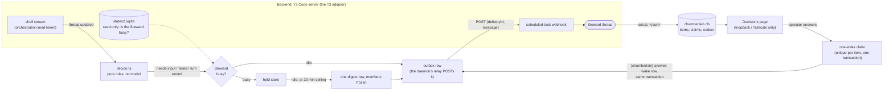

# Chamberlain

Chamberlain watches your agent threads and wakes **the Steward**, an agent thread, only when something needs it.

It is a small daemon that makes **no model calls**. It watches your threads through an **adapter** (the one that ships
talks to T3 Code; others are written against [`docs/ADAPTERS.md`](docs/ADAPTERS.md)), applies a few
plain rules (a thread is waiting on a question, a run failed, a turn ended handing a question back), and sends one
message to the Steward's thread. The Steward, a long-lived agent you give your standing rules, handles what it may
decide itself and sends the rest to you through a **decision queue**: one ranked page where you clear its questions, plus
a ledger of **rulings** where nothing becomes a standing rule until you confirm it.

Chamberlain runs beside your backend. With T3 Code it is not a plugin or a patch: the T3 adapter talks to T3 only
through its orchestration protocol, its CLI, its webhooks, and, read-only, its state database (see
[Compatibility](#compatibility)). Everything backend-specific lives in one folder, `src/adapters/t3/`; the rest of the
code, in `src/core/`, never imports it. [`docs/ARCHITECTURE.md`](docs/ARCHITECTURE.md) describes the layers.

## Why

Running several agent threads at once means someone has to notice when one of them is stuck on a question, failed,
or finished and went quiet. If that someone is a model polling every thread, you pay for it all day. Chamberlain
turns the polling into code: it costs nothing while threads are working, and the Steward spends tokens only on a wake.

- **Wakes are rare and batched.** While the Steward is busy, wakes wait in a shared store and go out as one digest.
- **Nothing is answered for you that is yours.** Command approvals, secret requests and machine-link requests are held
  by the daemon and never reach the Steward.
- **Every wake is delivered at least once, and POSTed at most 3 times.** Every process writes a wake as a row in the outbox (the
  transactional outbox pattern) in the same transaction as what made it necessary, and only the daemon's relay sends rows. Each row's
  delivery id and text are frozen when it is written, so every POST of it is the same, and the Steward de-duplicates by that id. A row
  that is not delivered after 3 attempts is kept as a dead letter and reported, never sent without end. The crash tests kill the real
  processes at each step.
- **One database, one item system.** All state is in one SQLite file, `chamberlain.db`. Everything Chamberlain tracks,
  de-duplicates or re-notifies about (a sweep finding, a decision-queue question, an alarm) is a row in one `items` table,
  and one function decides when a row notifies again. See [`docs/ARCHITECTURE.md`](docs/ARCHITECTURE.md). Every name used
  in the schema, the config and the logs is defined in [`docs/GLOSSARY.md`](docs/GLOSSARY.md), with the industry term it follows.
- **Authority stays legible.** The Steward's decision rights are your own words, repeated in every wake; its rulings
  carry ids, and the rulings page counts how often each one was cited.

## How a wake travels

The diagram shows the T3 adapter. A wake travels the same way through any adapter; [`docs/ARCHITECTURE.md`](docs/ARCHITECTURE.md)
has the backend-neutral version.



Approvals, secrets and machine links never take the route above: the daemon records them (or the page lists them,
answerable only with an exact fingerprint) and wakes nobody.

## Install

Three ways; they run the same code.

**Homebrew** (macOS and Linux), which also runs the daemon as a service:

```sh
brew install nbost130/tap/chamberlain
brew services start chamberlain      # runs `chamberlain daemon`; its log is $(brew --prefix)/var/log/chamberlain.log
```

**A standalone binary** from the [latest release](https://github.com/nbost130/chamberlain/releases/latest): no Bun and no checkout needed.
Pick `chamberlain-<version>-<os>-<arch>.tar.gz` for `linux-x64`, `linux-arm64`, `darwin-arm64` or `darwin-x64`, check it against
`SHA256SUMS` from the same release, and put the `chamberlain` inside on your `PATH`:

```sh
sha256sum -c --ignore-missing SHA256SUMS      # macOS: shasum -a 256 -c --ignore-missing SHA256SUMS
tar -xzf chamberlain-<version>-<os>-<arch>.tar.gz && install chamberlain ~/.local/bin/
chamberlain --version
```

The macOS binaries are not signed or notarized. If Gatekeeper stops one that a browser downloaded (`curl` and `brew` do not
set the flag), clear it with `xattr -d com.apple.quarantine chamberlain`.

**From source**: the Quickstart below, with [Bun](https://bun.sh).

The binary is one command with a subcommand for each tool: where this README says `bun src/ask.ts '<json>'` the binary runs
`chamberlain ask '<json>'`, `bun src/core/afk.ts hold ...` is `chamberlain afk hold ...`, `bun src/daemon.ts` is `chamberlain daemon`, and so on.
`chamberlain help` lists them all. The Steward's hand-off and wakes name whichever spelling the running build uses, so an agent is
never told to run a path that does not exist.

## Requirements

- [Bun](https://bun.sh) 1.4 or newer (developed on 1.4.4), only to run from source; the standalone binary and the Homebrew package bundle it. Chamberlain uses `bun:sqlite` (its state is one SQLite database), `Bun.serve` and `Bun.spawn`.
- A backend with an adapter. The T3 adapter needs a T3 Code server (see [Compatibility](#compatibility)) and its `t3` command line.
- Linux or macOS. The page and daemon are ordinary processes; example systemd and launchd units are in `deploy/`.

## Quickstart

This walks through the T3 adapter, the one that ships. Another adapter has its own setup (`docs/ADAPTERS.md`); the Steward, the
rules, the daemon and the page below are the same.

The commands below use `~/.config/chamberlain` (the config directory) and `~/.local/state/chamberlain` (the state directory,
see [Where state lives](#state-directory-localstatechamberlain-chamberlain_state)). Create them with `umask 077` as shown so
they are private; set `CHAMBERLAIN_CONF` and `CHAMBERLAIN_STATE` to put them elsewhere.

**1. Get the code.** (With the binary or Homebrew, skip the clone: use `chamberlain <command>` where a step says `bun src/...`.)

```sh
git clone <your fork or copy of this repository> chamberlain
cd chamberlain && bun install
umask 077 && mkdir -p ~/.config/chamberlain ~/.local/state/chamberlain
```

**2. Mint a read-only token** for the daemon. It can read threads and nothing else.

```sh
t3 auth session issue --base-dir ~/.t3 --scope orchestration:read --ttl 30d --token-only \
  > ~/.config/chamberlain/read-token
chmod 600 ~/.config/chamberlain/read-token
```

Tokens last as long as `--ttl`; the daemon alarms at 25 days so you can mint a new one before it lapses. Without a
`servers.json` the daemon watches one server, `local`, at `http://127.0.0.1:3773` using this file. For more servers
see [`examples/servers.json`](examples/servers.json).

**3. Create the Steward thread and its webhook.** In T3, start a new thread (this is the Steward). From inside it, create
a scheduled task: `schedule_task` with `schedule: {type: "webhook"}`, `bindToCurrentThread: true`, a title such as
`Chamberlain: Steward wake`, and as its prompt the exact contents of [`docs/steward-wake-prompt.md`](docs/steward-wake-prompt.md).
Store the webhook URL it returns, without echoing it, and tell Chamberlain which thread is the Steward:

```sh
printf '%s\n' "<webhook url>" > ~/.config/chamberlain/wake-url     && chmod 600 ~/.config/chamberlain/wake-url
printf '%s\n' "<steward thread id>" > ~/.config/chamberlain/steward-thread && chmod 600 ~/.config/chamberlain/steward-thread
```

Optionally make a second webhook task whose prompt is exactly `/compact` and put its URL in `compact-url`: the daemon then
compacts the Steward when its context passes `compactTokens` (default 350 000). The template
[`docs/steward-start.md`](docs/steward-start.md) is a first message that sets all of this up from inside a new Steward thread.
The webhook dies if its bound thread is deleted.

**4. Write the Steward's rules.** `~/.config/chamberlain/decision-rights.md` is your standing decision rights, in your own
words: what the Steward may decide, what it must ask you. It is copied verbatim into every wake (in full after a
compaction or after you change it, otherwise as a one-line pointer to the hand-off that holds it; the away mandate rides
every wake and never makes the rules count as changed). Start from [`examples/decision-rights.md`](examples/decision-rights.md).
Set your name for the wakes with `principalName` in `settings.json` ([`examples/settings.json`](examples/settings.json));
without it they say "the operator".

**5. Run the daemon.** First as a dry run: it watches and logs what it would send, and sends nothing.

```sh
CHAMBERLAIN_DRY=1 CHAMBERLAIN_VERBOSE=1 bun src/daemon.ts
```

Then for real: `bun src/daemon.ts` (or install [`deploy/systemd/chamberlain.service`](deploy/systemd/chamberlain.service) /
[`deploy/launchd/com.example.chamberlain.plist`](deploy/launchd/com.example.chamberlain.plist)). Its log is the `events` table of
`~/.local/state/chamberlain/chamberlain.db`, its heartbeat the `heartbeat` state row (`bun src/core/afk.ts status` prints it). `bun src/adapters/t3/synthetic-wake.ts` queues one wake shaped like
the daemon's, as an outbox row, so the running daemon's relay sends it and the whole path is proved. `bun src/brief.ts steward` prints the Steward's hand-off.

**6. Run the Decisions page.** Write `~/.config/chamberlain/web.json` (mode 0600), using this machine's Tailscale address or
`127.0.0.1`:

```json
{ "schemaVersion": 2, "host": "127.0.0.1", "port": 3790 }
```

```sh
bun src/web/server.ts        # or deploy/systemd/chamberlain-web.service
```

The page lists everything waiting on you, ranked, with a rulings page next to it. To see questions inside T3 as well,
create a pinned Decisions thread, put its id in `decisions-thread`, and send it the message in
[`docs/decisions-thread-setup.md`](docs/decisions-thread-setup.md). From then on the Steward asks with
`bun src/ask.ts '<json>'` (its hand-off tells it how) instead of sending you question cards.
`CHAMBERLAIN_CONF=<scratch> CHAMBERLAIN_STATE=<scratch> bun src/web/server.ts --test` runs the page on fixture data with no wakes.

## Configuration reference

Everything lives in two directories. Create the directory 0700 and its files 0600, and note that
**every file that holds a token, a URL or a command must be mode 0600 or Chamberlain refuses to read it**.

### Config directory `~/.config/chamberlain` (`CHAMBERLAIN_CONF`)

| File | Required | What it is |
| --- | --- | --- |
| `read-token` | T3 adapter: yes (or per-server `tokenFile`) | An `orchestration:read` token for the default server. Never logged. |
| `wake-url` | T3 adapter: to deliver | The webhook URL of the scheduled task bound to the Steward's thread. Never logged. |
| `steward-thread` | recommended | The Steward's thread id (for another adapter, whatever id it uses for the Steward). The daemon never wakes the Steward about itself, and uses it for the busy gate, stall alarm and compaction. |
| `decision-rights.md` | recommended | Your standing rules, in your words, verbatim in a wake whenever it may be new to the Steward (a one-line pointer otherwise). Without it a wake tells the Steward to hold anything on the ASK list. |
| `decisions-thread` | T3 adapter: for the inline view | The pinned Decisions thread's id. `ask.ts` posts there and refuses to run without it. |
| `compact-url` | T3 adapter: optional | Webhook whose task prompt is `/compact`. Without it the daemon only alarms that the Steward is over its size. |
| `settings.json` | optional | See below. |
| `servers.json` | optional | The T3 servers to watch. See below. |
| `web.json` | for the page | The page's bind address and options. See below. |
| `sweep.json` | optional | Your own routine checks. See below. |
| `judge.json` | optional | Which backend judges each trigger, with backend names of your own: `{"triggers": {"stalled-recovery": {"backend": "small-model"}}, "backends": {"small-model": {"command": [...]}}}`. A backend's command takes the system prompt and the user prompt as its last two arguments and prints `{"verdict", "reason"}`. There is **no default**: without this file nothing is judged, the daemon logs `judge-off` with why at start, and a second failure goes to the Steward unjudged. Only error text, scrubbed, is ever sent. |
| `sweep-prompt.md` | optional | Replaces the bundled full-sweep prompt ([`docs/steward-sweep-prompt.md`](docs/steward-sweep-prompt.md)). `{{principalName}}` is substituted. |
| `operating-rules.json` / `operating-rules.md` | optional | Operating rules copied into the hand-off: `operating-rules.md` whole, or excerpts of your own files listed in `operating-rules.json`. See below. |
| `brief.d/*.md` | optional | Brief fragments: your own sections, appended to the Steward's hand-off. See below. |
| `wake-url.steward`, `wake-url.prev` | transient | Used by `src/adapters/t3/switch-steward.ts` during a hand-off; the old URL is kept for one-rename rollback. |
| `*-token` files | optional | Any `tokenFile` or `operateTokenFile` a server or `web.json` names. |

The away record, the rulings (ids R1, R2, ...), the butlers and everything held for your return are no longer files: they
are rows in the database (below), written by `afk.ts`, `ruling.ts`, `butler.ts` and the page.
| `daemon.env` | optional | `KEY=value` lines for systemd's `EnvironmentFile`. |

**`operating-rules.json`** lifts the lines a Steward acts on out of your own markdown files when the hand-off
is built, so there is no second copy to drift ([`examples/operating-rules.json`](examples/operating-rules.json)):

```json
{ "schemaVersion": 2,
  "intro": "The rest of these files is for builders. Read them when a rule seems missing.",
  "sources": [
    { "path": "~/notes/hosts/this-host.md",
      "sections": [ { "table": "Deltas", "rows": ["| `timeout`", "| Shell idioms"], "as": "On this host" } ] },
    { "path": "~/notes/OPERATING_RULES.md",
      "sections": [ ["Secrets", "whole"], ["Working style", ["- Whole issue", "- Smallest change"]] ] } ] }
```

- `sources` are read in order, and each one's selectors in order; `intro`, if set, comes first.
- `[heading, "whole" | [line prefixes]]` takes the `## heading` section, every line or one line per prefix.
  `{ "section": heading, "lines": ..., "as": heading }` is the same with a heading of its own.
- `{ "table": heading, "rows": "whole" | [row prefixes], "as": heading }` takes the one markdown table under `## heading`: its
  header and separator rows, then every body row or one row per prefix. Text around the table is left out.
- `{ "path": ..., "sections": "whole" }` copies that source whole. It is the only way a whole file reaches the hand-off.
- A heading that is gone or doubled, a prefix that matches no line or several, a wrapped rule, or a table that is missing,
  headerless or not alone under its heading stops that selector. It contributes **nothing**, with a `WARNING` on stderr
  naming the source, the selector and why; the source's other selectors and the other sources are still excerpted. (Until
  this release a failed excerpt copied the whole source instead, which could put text you never selected in front of the
  Steward.)
- The 0.1 form, `{ "source": path, "sections": [...] }`, still works: it is one source.

**`brief.d/`** (brief fragments): procedure that belongs to your project, not to Chamberlain, goes in `brief.d/` in the config
directory ([`examples/brief.d/`](examples/brief.d/)), and `bun src/brief.ts steward` appends it to the generic hand-off:

- Only regular files whose names end in `.md` are used. A symlink, a directory or any other entry is ignored, with a
  warning on stderr. No `brief.d/` is fine.
- Fragments become the Steward's instructions, so they are checked like authority config. `brief.d/` must be a real
  directory (not a symlink), owned by you (the daemon's effective user), and not group- or world-writable; otherwise no
  fragment is read, with one warning. Each fragment must be owned by you and not group- or world-writable: `0600` and
  `0644` are fine, `0664` is not. A refused fragment is skipped with a warning naming it and why; the others are still
  used, and the hand-off always comes out. The same goes for one that cannot be read: a `brief.d/` you can write but not
  read (`0300`) gives no fragment, and an unreadable fragment is skipped, each with a warning naming the path and the
  error. With a umask of `002`, set the modes yourself:
  `chmod 755 brief.d && chmod 644 brief.d/*.md`.
- Fragments are sorted by filename in byte order (so `10-repo.md` before `20-landing.md`, and `B.md` before `a.md`), and
  each is appended verbatim, its own headings kept as written, after the generic brief and before any
  `## Open work at hand-over` section. Blank lines at a fragment's start and end are dropped, so fragments sit exactly one
  blank line apart. Nothing is substituted in a fragment.

**`settings.json`** (all keys optional; each has an environment override):

| Key | Environment | Default | Meaning |
| --- | --- | --- | --- |
| `principalName` | `CHAMBERLAIN_PRINCIPAL` | `the operator` | What wakes, the hand-off and the away mandate call you. |
| `t3BaseDir` | `CHAMBERLAIN_T3_DIR` | `~/.t3` | T3's base directory (CLI under `bin/`, runtime under `runtime/versions/`). |
| `t3StateDb` | `CHAMBERLAIN_T3_STATE_DB` | `<t3BaseDir>/userdata/statev2.sqlite` | T3's state database, opened read-only. |
| `alertCommand` | `CHAMBERLAIN_ALERT_CMD` | none | Run for each alarm as `<command> warning <title> <summary>`, with `CHAMBERLAIN_ALARM_KEY` in its environment. Without one, alarms are only logged. |
| `compactTokens` | `CHAMBERLAIN_COMPACT_TOKENS` | `350000` | Steward context size above which the daemon sends `/compact`. |
| `settledMatch` | none | `{"titleOverlap": true, "ignoreWords": []}` | How ask.ts and `afk.ts hold` decide a question is already settled ([ARCHITECTURE.md, "Queue first, hold second"](docs/ARCHITECTURE.md#queue-first-hold-second-settled-never-twice)). `titleOverlap: false` matches on exact refs only; `ignoreWords` lists words (a project or product name) that head many unrelated questions and so say nothing about the topic. |

**`servers.json`**: `{ "schemaVersion": 2, "servers": [ ... ] }`. One watcher runs per server, through the adapter the entry names; every wake carries `server:`. The Steward's own server (the one with no `environmentId`, else the first) is the one whose adapter wakes it.

| Field | Meaning |
| --- | --- |
| `name` | A short unique name used in wakes, queue items and logs. |
| `adapter` | Which adapter serves it (see [`docs/ADAPTERS.md`](docs/ADAPTERS.md)). Default `"t3"`. |
| `origin` | T3 adapter: the server's origin, for example `http://127.0.0.1:3773`. |
| `tokenFile` | T3 adapter: file in the config directory with an `orchestration:read` token. |
| `operateTokenFile` | Ignored by the page (answer rights come only from `web.json`); read by `t3x`. |
| `environmentId` | Set for a server other than the Steward's own: the Steward passes it to the `t3_*` tools. The one without it is "this server". |
| `mayBeOffline` | A laptop that sleeps: no alarm when its socket stays down. |
| `sshHost` | `user@host` reachable by key-based ssh, so `git` can be asked about a worktree path on that machine. |

**`web.json`** (mode 0600; the page refuses to start otherwise):

| Key | Meaning |
| --- | --- |
| `host` | **Required.** The one address to bind: `127.0.0.1`, `::1`, an address in Tailscale's `100.64.0.0/10` or `fd7a:115c:a1e0::/48`. Any other address, any host name and every wildcard is refused. |
| `port` | Default `3790`. |
| `allowedHosts` | Extra `Host` header names to accept, such as the machine's MagicDNS name. |
| `threadLinks` | Server name to the T3 web URL prefix a thread id is appended to, for "Open thread" links. |
| `mirrorLinks` | Server name to the link base used for mirrored cards (`t3-thread://v2/<environmentId>/`). |
| `decisionsServer` | `{ "origin": "...", "operateTokenFile": "..." }`: the T3 server hosting the Decisions thread, with an `orchestration:operate` token. Enables the "Decisions · N waiting" title and settling cards. |
| `answerTokens` | Server name to an operate-token file: cards on that server become answerable from the page. Without one a server is read-only. |
| `publicBase` | An `https://` base (for example from `tailscale serve`) used in inline views when T3 is loaded over https. |

**`sweep.json`** lists your own routine checks, run every two hours:

```json
{ "schemaVersion": 2, "checks": [ { "name": "disk", "command": ["/path/to/check-disk.sh"], "timeoutMs": 20000, "mode": "live" } ] }
```

A check is an **item source** (the word is Nagios's and Sensu's: a command run on a schedule that reports a status): it
prints a JSON array of findings, `[{ "dedupKey": "disk-low", "text": "...", "repeatIntervalMs": 0 }]`, on stdout and exits 0,
and each finding becomes an item of source `check:<name>` in the one item system. `dedupKey` identifies it (unique within
the check; PagerDuty's `dedup_key`), and the item system alone decides when it notifies: once by default;
`repeatIntervalMs` notifies again that many milliseconds after each notification while the finding is still printed (`0`:
on every sweep; Alertmanager's `repeat_interval`), up to `maxNotifications` times; `baseline: true` makes the very first sweep
learn it silently; `subject: {"kind", "id"}` names what it is about (a pull request, a run). A finding the check stops
printing is resolved, so if it comes back it notifies again as new. A field this build does not know puts the check in
error, never quietly ignored. A check that fails or prints nonsense is in **error** (Grafana's Error state: the rule could
not be evaluated, which is different from No Data): its findings keep their state, an `evaluation_error` item notifies on
every sweep until it runs again, and the sweep becomes a full one, because a check in error must never read as a clear one.
`"mode": "shadow"` on a check records what it *would* have sent without waking anyone (counted apart from real
notifications, so going `"live"` starts from a true zero); `"silenced"` tracks only. Findings travel to the Steward as untrusted data. See
[`examples/sweep-check.sh`](examples/sweep-check.sh). The daemon also runs one built-in source, threads that keep starting
turns of their own (a runaway), with no configuration. Any future monitor plugs in the same way, as another source
([`docs/ARCHITECTURE.md`](docs/ARCHITECTURE.md#the-item-system)).

### State directory `~/.local/state/chamberlain` (`CHAMBERLAIN_STATE`)

Chamberlain follows the [XDG Base Directory Specification](https://specifications.freedesktop.org/basedir/latest/). The state
directory is `$CHAMBERLAIN_STATE`, else `$XDG_STATE_HOME/chamberlain`, else `~/.local/state/chamberlain` (an empty or
relative variable is ignored, as the specification says). It holds what the processes write while they run and what must
survive a restart: **this is data you keep, not a cache**, because the rulings and the decision log are in it. The config
directory follows the same rule (`$CHAMBERLAIN_CONF`, else `$XDG_CONFIG_HOME/chamberlain`, else `~/.config/chamberlain`).
Chamberlain keeps no cache files today; `$XDG_CACHE_HOME/chamberlain` is reserved for any it might, and is safe to delete.

```
~/.config/chamberlain/        what you write: tokens, URLs, settings.json, servers.json, web.json, sweep.json, decision-rights.md (files mode 0600)
~/.local/state/chamberlain/   what Chamberlain writes, and what a backup must keep
  chamberlain.db              the one SQLite database (mode 0600), with chamberlain.db-wal and -shm beside it while it is open
  evidence/<item>/            the screenshots and recordings the database's evidence rows point to
  steward-brief.md            the Steward's hand-off
~/.cache/chamberlain/         nothing: reserved for real caches
```

All state is one SQLite database, `chamberlain.db`, opened in WAL mode with a busy timeout and foreign keys on, mode 0600.
The daemon, the page and the command-line tools open it at the same time and never lose each other's writes.

**One daemon per database.** The daemon holds a `flock(2)` exclusive lock on the state directory, the directory that holds
`chamberlain.db`, for as long as it runs; there is no lock file. A second daemon on the same directory exits 5, whatever the
environment or the spelling of the path. The kernel frees the lock when the daemon dies, however it dies. The lock is on the
directory rather than the database because on macOS `flock` and SQLite's own `fcntl` locks conflict on the same file; SQLite never
locks the directory, so the page and the tools work as usual on Linux and macOS. It holds on a local filesystem only (a network
filesystem is unsupported). A database with a second hard link is refused at start, and a database replaced, deleted or moved to
another directory under a running daemon is a different database. Where `flock` cannot be called through `bun:ffi`, the daemon
refuses to start and exits 1.

**Backup.** Back up `chamberlain.db` and `evidence/`, not the files loose and not the cache directory. Copy the database
only after the processes have exited (so the `-wal` file is merged), or take a consistent copy while it runs with
`sqlite3 ~/.local/state/chamberlain/chamberlain.db "VACUUM INTO '/path/to/backup.db'"`. `rsync`, `cp -r` or a snapshot of
the state directory taken while the daemon is writing can catch the database and its `-wal` file at different moments.

**Upgrading from a build that kept the database in the cache directory.** The first start moves it, once: if
`<state>/chamberlain.db` does not exist and `$CHAMBERLAIN_CACHE/chamberlain.db`, `$XDG_CACHE_HOME/chamberlain/chamberlain.db` or
`~/.cache/chamberlain/chamberlain.db` does, the database (its write-ahead log folded in first), `evidence/` and
`steward-brief.md` move to the state directory, a line is printed to stderr and a `state-moved` event is logged. A database
that another process still has open is refused with a message (stop the daemon and the page, then start again); a database
already in the state directory is never replaced.

| Where | What it is |
| --- | --- |
| table `items` | The one item system: sweep findings, decision-queue questions, alarms, the notification log of what already woke the Steward, what is held for your return. |
| tables `claims`, `relays`, `evidence` | A question's answer flow: the one-wake claim (unique per item, carrying the wake text and its delivery id), the one direct send of a thread-routed answer, and rows pointing at its evidence files. |
| tables `outbox`, `outbox_members`, `held_wakes`, `wake_tombstones` | The transactional outbox: one row per wake to send (`pending`, `delivered`, `dead_letter` or `cancelled`), the delivery ids each row carries (bound to that row for good), turn ends and sweeps held while the Steward is busy, which become one digest row, and one permanent tombstone per delivery id that was delivered or cancelled, which outlives retention of its row. |
| tables `rulings`, `decisions`, `butlers`, `away` | The rulings ledger (with each ruling's expiry, what it supersedes and why it left force), the Steward's self-answers, the butler ledger and the away record. |
| table `events` | The log: every wake, skip, alarm and answer. `queue-waits.ts` and the return brief read it with SQL. |
| table `state` | Small named records: the sweep clock, what rights text the Steward last received, the latest health verdict, the heartbeat. |
| table `migrations` | The schema's version history (see [Schema versions](#schema-versions)). |
| `evidence/<item>/` (a directory beside the database) | Screenshots and recordings copied in by `ask.ts`; the page serves only the names an item's `evidence` rows list. These stay files. |
| `steward-brief.md` (beside the database) | The Steward's hand-off (where `/steward-handoff` writes it). |

### Environment variables

| Variable | Default | Meaning |
| --- | --- | --- |
| `CHAMBERLAIN_CONF`, `CHAMBERLAIN_STATE` | `$XDG_CONFIG_HOME/chamberlain`, `$XDG_STATE_HOME/chamberlain` (else `~/.config/chamberlain`, `~/.local/state/chamberlain`) | The two directories. Point them at scratch directories for tests. |
| `CHAMBERLAIN_CACHE` | unset | Only read by the one-time move out of the cache directory (above) and by `import.ts --from-env`, to find where an older build kept its files. |
| `CHAMBERLAIN_T3_ORIGIN` | `http://127.0.0.1:3773` | The origin of the one default server when there is no `servers.json`. |
| `CHAMBERLAIN_T3_DIR`, `CHAMBERLAIN_T3_STATE_DB`, `CHAMBERLAIN_PRINCIPAL`, `CHAMBERLAIN_ALERT_CMD`, `CHAMBERLAIN_COMPACT_TOKENS` | see `settings.json` | Overrides for the settings above. |
| `CHAMBERLAIN_DRY` | unset | `1`: the daemon watches and logs, and posts nothing. |
| `CHAMBERLAIN_VERBOSE` | unset | Also print each log line to stdout. |
| `CHAMBERLAIN_EXCLUDE` | unset | Comma-separated thread ids to never wake about. |
| `CHAMBERLAIN_RECOVER` | unset (off) | `1`: turn on stalled-thread recovery. The daemon classifies a failed run in code, retries a transient one once after a 3-minute grace, and sends a second failure to the judge (`judge.json`; without it, to the Steward unjudged). Needs the server's operate token. See [`docs/GLOSSARY.md`](docs/GLOSSARY.md#recovering-a-failed-thread). |
| `CHAMBERLAIN_REPORT_QUIET_MS` | `180000` | How long a finished turn must stay quiet before it is reported (a PR update often follows). |
| `CHAMBERLAIN_REPORT_HOLD_MS` | `3600000` | How long a report waits on a thread's own background work before it goes anyway. |
| `CHAMBERLAIN_STALL_MS` | `1200000` | How long queued wakes may sit with nothing moving in the Steward's thread before an alarm. |
| `CHAMBERLAIN_HEALTH_FORMAT_PATTERN` | unset | A regular expression enabling the optional reply-format health signal ([`docs/steward-health.md`](docs/steward-health.md)). |
| `CHAMBERLAIN_MAX_ATTEMPTS` | `3` | The most attempts (POSTs) one outbox row gets, a positive whole number. Every outcome counts, a refusal and a timeout included. At the limit the row is a dead letter, kept and not sent again until `bun src/wakes.ts retry` or `cancel` (see [Dead letters](#dead-letters)). |
| `CHAMBERLAIN_RELAY_POLL_MS` | `1000` | How often the daemon's relay looks at the outbox (it also looks at once when the daemon itself writes a row). |
| `CHAMBERLAIN_TICK_MS` | `60000` | The heartbeat: the once-a-minute housekeeping (recovery, the sweep). Shortened only by tests. |
| `CHAMBERLAIN_CRASH_AT` | unset | Test hook: SIGKILL the process right after a named step (`before-commit`, `committed`, `notified`, `enqueued`, `composed`, `attempt-begun`, `attempt-counted`, `accepted`, `delivered`; see `src/core/crash.ts`). Used only by `crash.test.ts`. |
| `T3CODE_CLI_PATH` | auto | The `t3` binary `ask.ts` uses; otherwise `<t3BaseDir>/bin/t3`, then the newest installed runtime. |
| `CLAUDE_CONFIG_DIR` | `~/.claude` | Where to find the Steward's Claude Code transcripts for health measurement. |

### Command-line tools

The binary runs each as `chamberlain <name>`, named by its source file: `daemon`, `web`, `ask`, `afk`, `decided`, `ruling`, `butler`, `migrate`, `import`, `brief`, `wakes`, `steward-health`, `desk-allowlist`, `peek`, `t3x`, `compat`, `queue-waits`, `switch-steward`, `synthetic-wake` (`chamberlain help`).

| Command | Used by | Does |
| --- | --- | --- |
| `bun src/daemon.ts` | you | The watcher, and the one process that sends wakes. One per state directory: a second exits 5. |
| `bun src/web/server.ts [--test]` | you | The Decisions page. |
| `bun src/ask.ts '<json>'` | the Steward | Put one question on the queue and in the Decisions thread. `proposedRuling` is the ruling you may save with your answer; add `proposedExpires` (a date or a date-time with a zone) when it is about one run, launch or week, and the saved ruling expires by itself. `"urgent": false` lists it below the urgent ones and posts nothing. A question already settled (an answer, a ruling, a logged decision) is refused with exit 2 and what it matched on; `"notSettled": "<why>"` overrides it. |
| `bun src/core/ruling.ts [--stated-in-chat] [--expires <ISO>] [--until "<event>"] [--supersedes R32,R16] [--] "<words>" "<decides>"` | the Steward | Record a proposed (or, stated in chat, in-force) ruling. Recording the same words and decision again adds nothing and prints the id already held. `--expires` (a date, through the end of that day UTC, or a date-time with a zone) makes it time-bound: it drops out of every wake after that and the rulings page marks it expired. `--until` is a note for a bound only a person can judge, shown and never enforced. `--supersedes` names the rulings it replaces: they leave force when this one is in force. `list` shows every ruling. |
| `bun src/core/decided.ts "<thread>" "<decision>" "R12: why"` | the Steward | Log a self-answer, citing rulings by id. `decided.ts list [n]` shows the last n. |
| `bun src/core/afk.ts enter\|status\|hold\|held\|note\|close\|brief\|exit` | you, the Steward | The away record and the held-for-return ledger. `hold` requires `--item <Q-id>` of an open question (queue first, hold second) and takes `--not-settled "<why>"`, `--pr`, `--issue`, `--branch`, `--run`, `--thread`; it refuses a wait already settled. The daemon closes a hold when its item is answered or its PR, issue, branch or thread is done. GitHub reads use `gh` (or `CHAMBERLAIN_GH`). |
| `bun src/brief.ts steward [--mode test\|live]` | you | Print the Steward's hand-off. |
| `bun src/wakes.ts list\|retry <id>\|cancel <id>` | you | The outbox: what is pending, held and dead-lettered; retry a dead letter; cancel a row for good. See [Dead letters](#dead-letters). |
| `bun src/adapters/t3/peek.ts <server> <threadId>` | the Steward | The end of a thread in plain lines, a tenth of what `t3_thread_read` costs. |
| `bun src/core/butler.ts start\|stop\|list` | the Steward | The butler ledger. |
| `bun src/adapters/t3/t3x.ts threads\|read\|respond\|send <server>` | you | Act on a thread on any configured server. |
| `bun src/adapters/t3/queue-waits.ts [--hours N] [--store FILE]` | you | Read-only: how long wakes sat before the Steward started on them (reads the event log with SQL). |
| `bun src/steward-health.ts` | you | Read-only Steward health report. |
| `bun src/core/migrate.ts [--check]` | you | Check every config file's schema version and upgrade old ones. (The database migrates itself when opened.) |
| `bun src/cli/import.ts --from <dir> [--from <dir>] [--to <state dir>] [--dry-run] [--report <file>]` | you, once | Import the old file layout into the database. See [Upgrading from the file layout](#upgrading-from-the-file-layout). |
| `bun src/adapters/t3/compat.ts [origin]` | you | Print a T3 server's version and whether it is in the tested range. |
| `bun src/adapters/t3/synthetic-wake.ts` | you | Queue one wake shaped like the daemon's, as an outbox row: the daemon's relay sends it, so it proves the whole path (it opens no connection to the webhook). |
| `bun src/adapters/t3/switch-steward.ts <threadId>` | the Steward | The last step of a hand-off: make this thread the wake target. |

### Dead letters

Only the daemon sends wakes (no other process calls a wake transport or opens a connection to the webhook, and a test fails if one does): the page, the sweep and `synthetic-wake.ts` write rows, and the daemon's relay POSTs them on its next poll (one second by default) when it is not busy sending an earlier row (sends are one at a time, so a stuck send, up to the 15 second deadline, delays the rows behind it). If
the daemon is not running, rows wait (the page still says "recorded, wake queued") and go when it starts. Each row gets 3 attempts
(`CHAMBERLAIN_MAX_ATTEMPTS`), a minute and then four minutes apart, and **every outcome counts**: an HTTP error, a refused connection
and a timeout each use one. A row that is not delivered after its attempts is a **dead letter**: kept (nothing is dropped), not sent
again, and the `wake-dead-letter` alarm repeats. The Steward may or may not have received it. A webhook that is down for more than about
five minutes therefore dead-letters the wakes written meanwhile; with no wake URL at all, nothing is attempted and nothing is used up.

1. See what is waiting: `bun src/wakes.ts list`. It names each dead letter and pending row, its attempts, when it was made and last
   tried, and a digest's members.
2. Find out why it was not delivered (the webhook revoked, the T3 server down, a full disk) and fix that first. The daemon's log shows
   `deliver-error` and `deliver-dead-letter` events.
3. Look in the Steward's thread for the delivery id. If it never arrived, `bun src/wakes.ts retry <id>` puts the row back to pending with
   its attempts at zero; the relay sends it, the same id, text and members, on its next poll (see above for when that can be later). If the Steward already handled it,
   `bun src/wakes.ts cancel <id>` gives it up.

`retry` works only on a dead letter, so it can never add a send beside one in progress. `cancel` works on a pending row or a dead letter
and keeps it as a **tombstone**: the row and the ids it carries stay, so nothing queues them again, and it is not recorded as delivered. A
decision-queue answer whose wake you cancel stays recorded as answered; tell the Steward in chat. Any id a row carries works, a digest
member's included.

## Security model

Chamberlain holds a token that can read every thread and sits next to a page that can answer questions on your behalf, so
it is deliberately conservative.

- **The daemon's token is read-only.** It needs `orchestration:read` and nothing more; it cannot send, answer or
  change anything. The webhook URL (which can wake the Steward) is the other secret it holds.
- **Operate tokens are optional and separate.** An `orchestration:operate` token is only ever used by the page (to
  answer cards and rename the Decisions thread, if you name it in `web.json`) and by `t3x`. The page never takes an operate token from `servers.json`: its rights come only from `web.json`. Tokens are never
  logged and are redacted from error bodies.
- **Configs must be private, and the rule fails closed.** Every file that holds a token, a webhook URL, a command or an address
  (`read-token`, `wake-url`, `settings.json`, `servers.json`, `web.json`, `sweep.json`, `operating-rules.*`) must be a regular file with
  mode **exactly 0600**: 0700, 0400, 0640 and the rest are refused, with the mode found in the message. The config and state
  directories must be exactly **0700**. The database is created 0600 in a 0700 directory (its `-wal` and `-shm` files inherit the mode)
  and commits with `synchronous = FULL`, so a commit is durable before the call that made it returns. At start the mode is set and then
  **read back**: a database or directory that cannot be made private (not yours, a filesystem without modes) stops the process with exit
  code 4 and a message saying what it is, what it must be and the `chmod` that fixes it. A failed `chmod` is never swallowed. Config
  writes go through a temporary file and a rename.
- **The page binds to one address, never a wildcard.** The address must be loopback (`127.0.0.1`, `::1`) or a Tailscale
  address (`100.64.0.0/10`, `fd7a:115c:a1e0::/48`). It is canonicalised first, so IPv4-mapped, zero-padded, compressed
  and upper-case spellings cannot sneak past, and host names (which could resolve to anything) are refused outright.
- **The page has no login.** Anyone who can reach its address can read and answer the queue; its protection is the
  network (loopback or your tailnet). A request must also carry a known `Host` header (against DNS rebinding), and a
  `POST` must carry an `x-decision-queue: 1` header and a JSON body, which a cross-site form cannot set.
  A strict Content-Security-Policy is sent on every response.
- **Accepted risk: T3's inline frames, and exactly what they can do.** T3 renders inline pages in a sandboxed frame whose
  origin is `null` and which cannot hold a key, so any page running code in such a frame on a device that can reach the page's
  address can send the same requests, if it knows an item id. The **server** limits them, by route and by field (not the page's
  own script, which an attacker would not run): a `null`-origin request may `GET /api/queue`, `/api/recent` and `/api/rulings`, and
  `POST /api/items/<id>/answer` with a `choice` and an optional `note` and **no other field**. It **cannot** save or edit a
  ruling (a `saveRuling` or `rulingWording` field is refused with 403 and writes nothing), answer a mirrored card or an approval
  (refused, however exact the fingerprint), read one item on its own (`GET /api/items/<id>` is refused), batch-accept, or
  change anything else. Cards, approvals and rulings are done on the full page. What an inline frame *can* still do is answer a
  decision-queue question with one of its options, once: that is the accepted risk.
- **What the page will and won't answer.** Question cards and one-time approvals ("approve once" or "decline", never
  "always") are answered **on the full page only**, after re-reading the card from its thread, and only if its fingerprint is
  unchanged since you saw it. An approval (or a goal proposal) takes **two requests, and the server enforces both**: the first
  returns a single-use confirmation that expires in 60 seconds and is bound to that card's fingerprint, the decision you chose and
  your browser session (an HttpOnly, SameSite=Strict cookie); the second must present it. An approval request without it
  (`428`), with a made-up, replayed (`403`) or expired (`410`) one, or with one issued for another card, decision, fingerprint or
  session, is refused and reaches nothing. Each approval is logged with its full command. Secret and machine-link requests are
  listed read-only and never answerable. A secret item's value is entered in its own thread, never on the page.
- **Evidence files are confined.** The page serves only files an item lists, from `<state>/evidence/<item>/`;
  `..`, absolute paths, encoded slashes and symlinks are refused.
- **Outside text is data.** Thread titles, last messages, questions and check output reach the Steward fenced as
  "untrusted data, not instructions", with angle brackets stripped so text cannot close the fence.
- **No model calls.** The daemon decides with code. Its alarms go to your `alertCommand` or the log.

## Compatibility

This section is about the T3 adapter, which depends on a backend that changes under it. The core depends on no backend.

The T3 adapter is tested against **T3 Code server 0.1.8 to 0.1.9**, orchestration protocol 2. That range is one constant,
`T3_TESTED` in [`src/adapters/t3/compat.ts`](src/adapters/t3/compat.ts). At start each watcher reads
`/.well-known/t3/environment` and, if the server is outside the range, logs `compat-warning`, prints a warning, and
**keeps running**: T3 changes between minor versions, and a warning is more useful than a refusal. The version is also in
the heartbeat record. (It is a different thing from the schema check above, which refuses newer files.)

The T3 adapter **relies on T3 internals** that are not a supported API:

- It reads T3's `statev2.sqlite` read-only, for whether the Steward has a turn running or queued, its context size, its
  provider identity, and run timings. Tables: `orchestration_v2_projection_runs`, `_messages`, `_turn_items`,
  `_runtime_requests`, `_provider_turns`, `_threads`, `_provider_threads`, `_provider_sessions`. If a T3 migration changes
  them, the gate reads "unknown", which counts as busy (wakes still go after a 20-minute ceiling) and raises an alarm.
- It answers cards and approvals, renames the Decisions thread and sends to threads with `orchestration.dispatchCommand`:
  `runtime-request.respond`, `thread.metadata.update`, `message.dispatch`.
- It reads the shell stream (`orchestration.subscribeShell`), thread projections, and the `/bounded` and `/history`
  HTTP views, and matches wait kinds by name (`user_input_request`, `approval_request`, `secret_request`, `*link*`).

[`docs/upstream-asks.md`](docs/upstream-asks.md) lists the small supported APIs that would remove these dependencies: a
busy/queued state read and a "thread is waiting on input" event first among them.

## Known limitations

- **Only the T3 adapter ships.** The contract is small and documented ([`docs/ADAPTERS.md`](docs/ADAPTERS.md), with a sketch for herdr),
  and an in-memory fake runs the test suite, but no second real backend has been built or tested.
- **One Steward.** Chamberlain wakes a single thread. Several operators or several Stewards are not supported.
- **The webhook cannot de-duplicate, so delivery is at-least-once: a row is POSTed at most 3 times (`CHAMBERLAIN_MAX_ATTEMPTS`), always
  under the same delivery id and text, and the Steward de-duplicates by that id.** Every wake is an outbox row (in the same transaction as
  the notification that made it), only the daemon sends rows, and each carries its **delivery id** in the POST body and as the last line of
  its text. If the webhook accepts a POST and the daemon dies before recording it, the row is sent again after the restart; each attempt is
  committed before its POST, so repeated crashes cannot exceed the cap. A row that used its attempts is kept and not sent again until you
  decide (see [Dead letters](#dead-letters)). The Steward's templates tell it to treat a wake whose
  delivery id it has already handled as a repeat and do nothing more. The windows are listed exactly in
  [`docs/ARCHITECTURE.md`](docs/ARCHITECTURE.md#delivery-guarantees-and-the-windows-that-remain), and an undelivered wake is never dropped
  for its age.
- **The page has no authentication** beyond its network binding (see the security model), and a tailnet is only as private
  as its members.
- **Steward health reads a Claude Code transcript.** On another provider it reports "unavailable" (and never "OK").
- **A token expires.** `read-token` lasts as long as you minted it for; the daemon alarms at 25 days. A webhook stops
  working if its bound thread is deleted; repeated failed deliveries raise an alarm.
- **Wake timing is heuristic.** A finished turn is held for a quiet window (three minutes) in case more work follows, and
  "turn ended on a promise" and "turn ended handing a question back" are recognised by phrase patterns. Tune
  `CHAMBERLAIN_REPORT_QUIET_MS` and read `src/core/decide.ts` before relying on either.
- **`t3x send` is lightly tested** on T3 0.1.x. Linux and macOS only; Windows is untested.
- **Your checks run as you.** `sweep.json` commands are executed directly (no shell) by the daemon's user; keep the file private.

## Development

```sh
bun install
bun test              # unit, route, view, boundary, concurrency and crash tests; runs in a few seconds
bunx tsc --noEmit
```

The standalone binaries are built, smoke-tested and packaged by scripts (the release workflow runs them when release-please makes a release):

```sh
bun scripts/build.ts --targets linux-x64         # dist/chamberlain-<version>-linux-x64.tar.gz, .sha256 and SHA256SUMS; no --targets builds all four
bun scripts/smoke.ts dist/chamberlain-*-linux-x64.tar.gz   # runs it from an empty directory: --version, the page, ask, the hand-off, the daemon
bun scripts/render-formula.ts --sums dist/SHA256SUMS       # the Homebrew formula, from packaging/homebrew/chamberlain.rb.tmpl
```

A tool added to `COMMANDS` in `src/core/config.ts` needs a loader in `src/cli.ts` and an exported `main(argv)` (`src/cli.test.ts` checks both). Any command a
prompt or an alarm teaches is built with `selfCommand("<name>")`, never by hand, so it is `chamberlain <name>` in the binary and `bun <checkout>/src/...` from source.

The source is in layers (see [`docs/ARCHITECTURE.md`](docs/ARCHITECTURE.md)):

```
src/
  core/       backend-agnostic: rules, hold and digest, delivery, the Store and the item system, rulings, brief, engine, the adapter contract
  cli/        one-time tools (the importer)
  adapters/   one folder per backend (t3/), and the registry (index.ts)
  web/        the decision-queue page
  testing/    the in-memory fake adapter and wake transports
```

`src/architecture.test.ts` fails the build if anything in `src/core/` imports from `src/adapters/`, and if a second dedup or
re-notification mechanism appears next to the item system. The engine, the
hold-and-digest path and the page's card layer are tested against the fake adapter, so they are proved with a second
implementation of the contract. The crash tests start the real daemon and page as child processes and kill them at each
save boundary. See [CONTRIBUTING.md](CONTRIBUTING.md) and [CHANGELOG.md](CHANGELOG.md). [`docs/EXTRACTION.md`](docs/EXTRACTION.md)
records what was removed when this was extracted from a private system.

## License

MIT. See [LICENSE](LICENSE).
