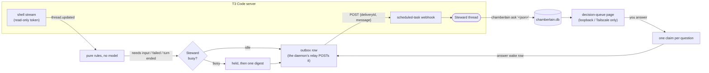

# Chamberlain

Chamberlain watches your T3 Code agent threads and wakes one of them, the **Steward**, only when something needs it; whatever the Steward
cannot decide goes to you on a **decision queue**.

- **No model calls while threads work.** Plain code does the watching, so the Steward spends tokens only when it is woken.
- **A wake is not lost.** Each one is written to the database with a fixed id and sent at least once, a crash included; the Steward
  ignores a repeat by its id.
- **The authority is in your words.** The Steward's decision rights are a file you write, repeated in every wake, and nothing becomes a
  standing rule until you confirm it.

## Install

```sh
brew install nbost130/tap/chamberlain
```

or a standalone binary (no Bun, no checkout) from the [latest release](https://github.com/nbost130/chamberlain/releases/latest): pick
`chamberlain-<version>-<os>-<arch>.tar.gz` for `linux-x64`, `linux-arm64`, `darwin-arm64` or `darwin-x64`, check it against `SHA256SUMS`,
and put the `chamberlain` inside on your `PATH`:

```sh
sha256sum -c --ignore-missing SHA256SUMS      # macOS: shasum -a 256 -c --ignore-missing SHA256SUMS
tar -xzf chamberlain-<version>-<os>-<arch>.tar.gz && install chamberlain ~/.local/bin/
chamberlain --version
```

The macOS binaries are not notarized. If Gatekeeper stops one that a browser downloaded, run `xattr -d com.apple.quarantine chamberlain`.
To run from a checkout instead, see [CONTRIBUTING.md](CONTRIBUTING.md). You need a T3 Code server on the machine and its `t3` command.

## Your first wake

**1. Start the Steward.** Make the two directories private, print the Steward's first message, and send it as the first message of a new
thread in T3. The Steward then creates its own wake webhook, tells Chamberlain where it is, and makes itself the thread that gets woken.

```sh
umask 077 && mkdir -p ~/.config/chamberlain ~/.local/state/chamberlain
chamberlain brief start
```

**2. Give the daemon a read-only token, and write your rules.** The token can read threads and nothing else. The rules are what the
Steward may decide and what it must ask you, in your own words; start from [`examples/decision-rights.md`](examples/decision-rights.md).

```sh
t3 auth session issue --base-dir ~/.t3 --scope orchestration:read --ttl 30d --token-only > ~/.config/chamberlain/read-token
chmod 600 ~/.config/chamberlain/read-token
$EDITOR ~/.config/chamberlain/decision-rights.md
```

**3. Run the daemon, and send one test wake.**

```sh
brew services start chamberlain        # or, without Homebrew: chamberlain daemon
chamberlain debug synthetic-wake       # queues one wake; the running daemon sends it and the Steward answers it
```

To watch without sending anything first, run `CHAMBERLAIN_DRY=1 CHAMBERLAIN_VERBOSE=1 chamberlain daemon`. The page where you answer the
Steward's questions is `chamberlain web`; [docs/CONFIGURATION.md](docs/CONFIGURATION.md) says how to set it up.

## How a wake travels



Command approvals, secret requests and machine-link requests never take this route: the daemon records them, the page lists them, and
nobody is woken. [docs/ARCHITECTURE.md](docs/ARCHITECTURE.md) has the layers, and [docs/DELIVERY.md](docs/DELIVERY.md) the delivery rules.

## Design choices

- **T3's database is read read-only, and only for versions it was tested against.** T3 has no supported "is this thread busy?" call, so
  the adapter reads its state database; outside the tested range it warns, and a table that changed reads as busy rather than guessed
  at ([docs/upstream-asks.md](docs/upstream-asks.md) lists the API that would replace it).
- **A wake is an outbox row.** It is written in the same transaction as what caused it and sent by one relay, so a crash can neither lose
  it nor make a second, different one.
- **One adapter seam.** Everything specific to T3 is in `src/adapters/t3/` behind a small contract, and a test fails if the core imports
  an adapter, so another backend is a new folder ([docs/ADAPTERS.md](docs/ADAPTERS.md)).
- **Bun only.** State is one `bun:sqlite` file, the page is `Bun.serve`, and Bun compiles the whole thing to one binary: no Node build,
  native addon or second service to install.
- **Files that grant access must be mode 0600.** A token or webhook URL can read or wake every thread, so Chamberlain refuses to start
  on one that is looser, instead of warning.

## Documentation

| | |
| --- | --- |
| [docs/CONFIGURATION.md](docs/CONFIGURATION.md) | Every config file, the state directory, environment variables and commands |
| [docs/SECURITY.md](docs/SECURITY.md) | What the daemon and the page can do, and what they refuse |
| [docs/DELIVERY.md](docs/DELIVERY.md) | The outbox, the relay, retries and dead letters |
| [docs/COMPATIBILITY.md](docs/COMPATIBILITY.md) | The T3 versions it is tested against, what it relies on, known limits |
| [docs/alert-desk.md](docs/alert-desk.md) | The optional desk that explains your monitoring alerts |
| [docs/ARCHITECTURE.md](docs/ARCHITECTURE.md), [docs/ADAPTERS.md](docs/ADAPTERS.md), [docs/GLOSSARY.md](docs/GLOSSARY.md), [docs/ROADMAP.md](docs/ROADMAP.md) | How it is built, how to write an adapter, what each name means, what is next |
| [CONTRIBUTING.md](CONTRIBUTING.md), [CHANGELOG.md](CHANGELOG.md) | Developing it, and what changed |

MIT licensed: see [LICENSE](LICENSE).
