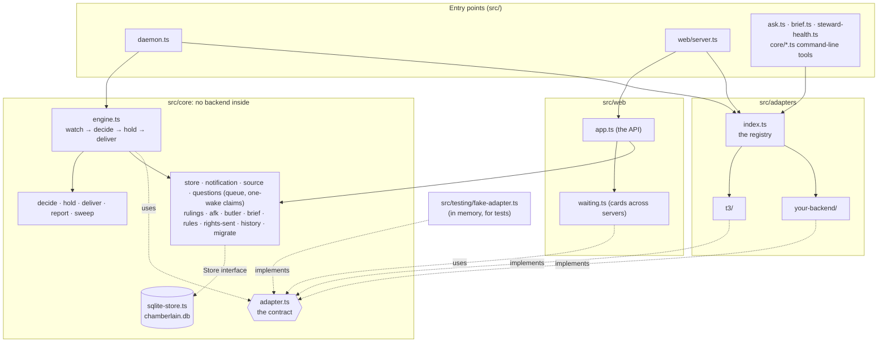
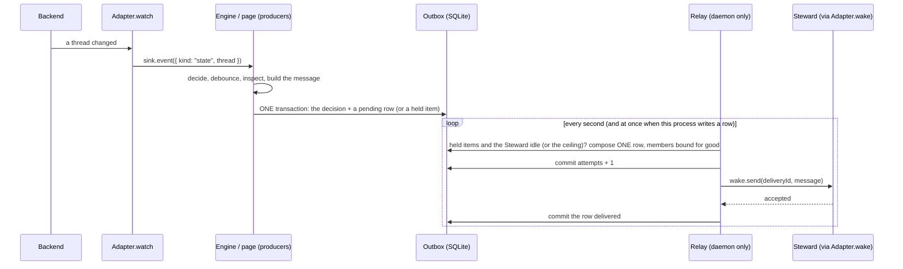
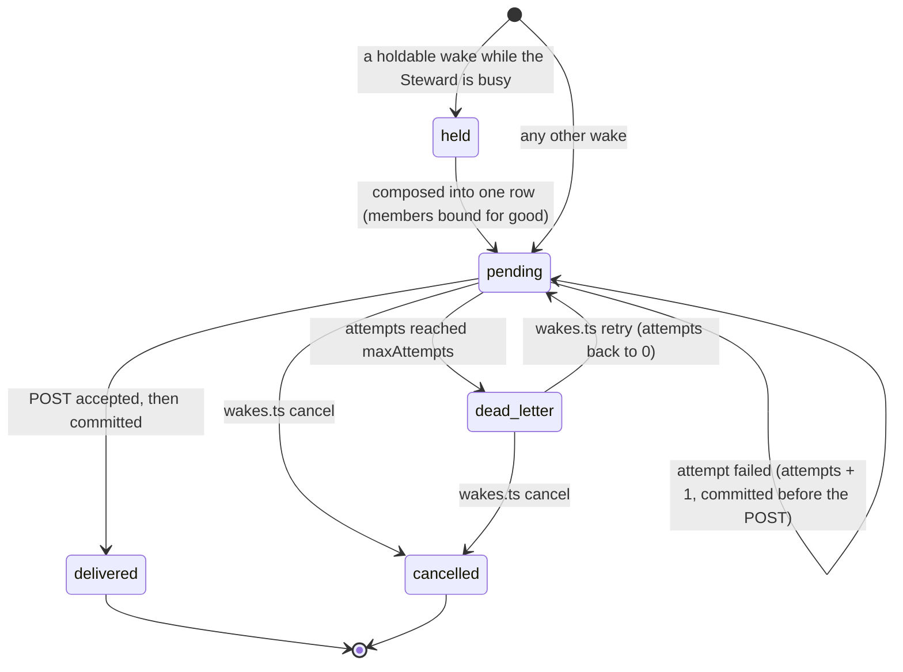
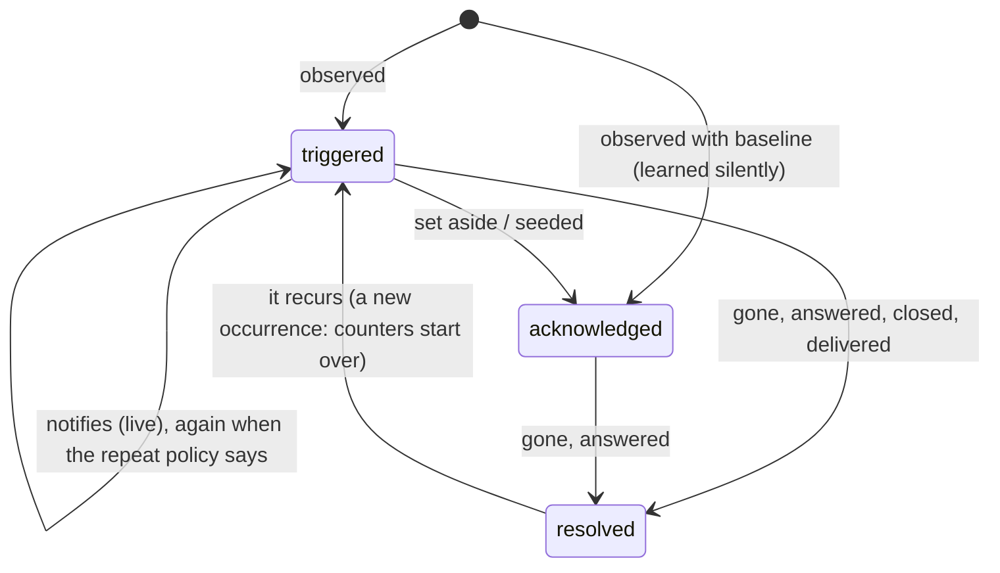

# Architecture

Chamberlain is a zero-model-call daemon around one idea: a few plain rules decide when a running agent thread needs a
person, and one long-lived agent thread, the **Steward**, is woken only then. Everything that depends on which agent
backend runs the threads (T3 Code, a terminal workspace manager, anything else) sits behind one interface, the
**adapter contract**. This page describes the layers, the contract, how a wake travels, where state lives (one SQLite
database), and the **item system** that decides what notifies. [GLOSSARY.md](GLOSSARY.md) defines every term this page uses and
the industry term each follows.

## Layers

| Directory | What lives there | May import |
| --- | --- | --- |
| `src/core/` | Everything that is true whatever the backend (the Alert Desk's inbox drain, `alert-desk.ts`, is here: it decides through the item system and queues wakes for the `desk` receiver, which a second relay sends): the rules that decide a wake (`decide.ts`), the hold and digest logic (`hold.ts`), the outbox's producer side (`deliver.ts`) and its one message relay (`relay.ts`, held to one per state directory by `singleton.ts`), the **`Store` interface** (`store.ts`) and its one SQLite implementation (`sqlite-store.ts`, `migrations.ts`), the item system (`alert.ts`, `source.ts`, `sweep.ts`), the decision queue and its one-wake claims (`questions.ts`), rulings, away mode, butlers, the hand-off (`brief.ts`), operating rules, history, the config files' schema version and its migration, and the engine (`engine.ts`) that ties them to an adapter. Core logic depends on the `Store` interface only; `sqlite-store.ts` is the one module that opens the database. | itself only |
| `src/cli/` | One-time tools: the importer (`import.ts`) that reads the old file layout into the database. | `src/core/` |
| `src/adapters/<name>/` | Every fact about one backend: its protocol, its tokens, its database, its wording. One folder per backend. | `src/core/` and its own folder |
| `src/adapters/index.ts` | The registry: a name to a factory, one line per backend. The only file that names more than one adapter. | everything under `src/adapters/` |
| `src/web/` | The decision-queue page: the JSON API (`app.ts`), the cards-across-servers layer (`waiting.ts`), the title keeper, the static files. Only `server.ts`, the entry point, touches the registry. | `src/core/` |
| `src/testing/` | Test doubles: the in-memory fake adapter, wake transports. | `src/core/` |
| `src/*.ts` | Entry points that need an adapter: `daemon.ts`, `ask.ts`, `brief.ts`, `steward-health.ts`. | `src/core/`, the registry |

The import rule is enforced by `src/architecture.test.ts`, which reads every import statement (type-only ones too) and
fails if anything in `src/core/` reaches into `src/adapters/`, if one adapter reaches into another, or if a page module
other than the entry point reaches into an adapter. It runs with the rest of `bun test`.

## The adapter contract

The contract is `src/core/adapter.ts`. Four capabilities are required; the rest are optional, and an adapter lists the
optional ones it has in `capabilities`. The core and the page degrade cleanly when one is missing.

| Capability | | What it is | Without it |
| --- | --- | --- | --- |
| `watch(sink, signal)` | required | Watches the backend and reports threads: `{ kind: "state", thread }` for every sighting of a thread (the core's rules find the events), or a ready-made `needs_input`, `failed` or `turn_ended`. Owns its own reconnecting. | not optional |
| `wake` | required | How a wake reaches the Steward: `ready()` and `send(deliveryId, message)`, one attempt with its own deadline. | not optional |
| `isBusy()` | required | Does the Steward have a turn running or queued: `idle`, `busy` or `unknown` (which holds like busy). Synchronous. | not optional |
| `post(item, opts)` | required | Shows one decision-queue question where the operator reads, as a live view when the page is up, else a notice. | not optional |
| `answer` | optional | Responds to a waiting card after re-reading it live. | the page shows waiting cards read-only, with where to answer them |
| `listWaiting` | optional | Everything waiting on the operator in this backend: the card mirror. | the page has no mirror for that server |
| `setTitle` | optional | Names the Decisions thread: "Decisions · 2 waiting". | no title keeper |
| `transcriptPath` | optional | Where the Steward's Claude Code transcript is, for the health check. | Steward health reports "unavailable", never "OK" |
| `inspect` | optional | Reads of one thread for building a wake: last message, what it waits on, subagents, its latest instruction. | a turn end wakes once per turn with no excerpt or question; there is no report gating |
| `send` | optional | Sends a message into a thread as the Steward. | an option routed straight to its thread goes to the Steward instead |
| `stewardProbe` | optional | The Steward's context size, stall and whether a compaction may go. | no stall alarm, no size tracking, no compaction |
| `handoffInstruction` | optional | How the Steward starts its own hand-off on this backend; the health check's HAND OFF verdict queues that wake. | the operator is asked to hand off instead |
| `compact` | optional | How a compaction request reaches the Steward. | the daemon only alarms that the Steward is over its size |

Thread states use one vocabulary whatever the backend says (`running`, `queued`, `starting`, `preparing`, `waiting`,
`completed`, `idle`, `interrupted`, `failed`), and `ThreadState` carries optional fields for data some backends have
(open pull requests, a worktree path, background work, parent thread). [ADAPTERS.md](ADAPTERS.md) says how to write one.

## How a wake travels

Delivery is a **transactional outbox** with **one message relay** (the daemon). Every producer (the engine, the sweep, the page's
answers, the one-time importer and `synthetic-wake.ts`) only **inserts rows**, inside the same transaction as whatever made the wake
necessary. Only the relay (`src/core/relay.ts`), in the daemon, calls a wake transport (the adapter's `wake`, and `compact` for the
compaction request, which has no row), and it cannot be built without the held one-relay lock: `createRelay` and `createEngine` take the
handle `holdRelayLock` returns, and refuse anything else, including a handle for another database: the handle records the device and inode
of the file it locked, and `createRelay` checks them against the file its store opened (`lockCovers`, `src/core/singleton.ts`). Every POST the relay makes, a wake or a compaction, goes through **one serial
queue** inside the relay, so the webhook never has two requests in flight (a compaction waits behind the wake being sent, and is not
retried: it has no row). No other process opens a connection to a wake webhook: the page and every
command-line tool reach the Steward only by writing to the database (inserting a row, or `wakes.ts` changing an existing row's status).
`src/architecture.test.ts` fails if any other module calls a transport (including by destructuring or aliasing it) or POSTs, if
production code imports or names a path under `src/testing/` (`testRelay` and its stub lock live there), or if production code has a
dynamic `import()` or `require()` whose argument is not a plain string literal; `src/adapters/t3/synthetic-wake.test.ts` runs a real relay
and two real tool runs against a webhook that counts concurrent requests. One daemon runs per state directory, enforced by the operating
system.

**What holds where.** The architecture tests are a spelling scan: they guard against *accidental drift* (a well-meaning change that adds a
second sender or reaches into the test helpers), **not against deliberately obfuscated code**. A module written to hide a call from a
regular expression will get past them, and nothing in this document claims otherwise. What holds at run time, whatever the source looks like,
is the runtime checks: the relay cannot be built without a lock handle that `holdRelayLock` made, that is still held, and that is the lock
on *this store's* database file (the device and inode it recorded, checked by `createRelay`); every POST goes through the relay's one serial
queue; and the test-only helpers (`testRelay`, `testRelayLock`, `holdTestRelayLock`) throw unless `NODE_ENV` or `BUN_ENV` is `test` or
`CHAMBERLAIN_TEST_ONLY=1`, so even a smuggled import cannot produce a working relay with a stubbed kernel lock in production
(`src/core/test-env.ts`, `src/core/test-env.test.ts`).

1. **The backend changes.** The adapter turns it into a normalized `ThreadState` and reports it. The core keeps the
   previous state of every thread and finds the transitions worth a wake in `decide.ts`: a request that appeared, a
   thread that went to `waiting`, a top-level run that `failed`, a top-level turn that ended.
2. **Settling.** The event waits a moment (2.5 s) and is re-checked on the newest state, so a burst of changes is one
   decision. A turn end then waits out a quiet window (3 minutes, `CHAMBERLAIN_REPORT_QUIET_MS`) and any background
   work or child threads, in case more work follows.
3. **Building the wake.** The engine asks the adapter's `inspect` for the last message, the waiting question and who
   gave the thread its latest instruction, and builds one message: what happened, the thread, the question or excerpt
   fenced as untrusted data, and the operator's decision rights. Approvals, secrets and machine links never reach the
   Steward: while the operator is away they are recorded in the held-for-return ledger, and the page lists them.
4. **Writing it.** `deliver.ts` (`createOutbox().commit`) writes the wake in the **same transaction** as the notification
   decision that made it necessary (which keys were notified, or the sweep's findings and clock): a crash leaves both or neither. A
   wake that may wait (a turn end, the sweep) becomes a **held item** (`held_wakes`); any other becomes a **pending row** at once. An id
   the outbox already knows, in any state, writes nothing: a delivered or cancelled wake is never enqueued again.
5. **Holding.** While `isBusy()` says the Steward is working (or `unknown`), held items wait. When the relay finds it idle, or it has
   been busy for the whole ceiling (20 minutes, once per ceiling), the relay **composes** everything held into ONE row in one
   transaction (`WakeStore.compose`): the row's delivery id, text and member list are frozen, every held item is bound to it (a member
   belongs to one row, ever), and the held items leave the held store. Several `turn_ended` items about one thread are folded into the
   latest at this moment, and the row records how many (`folded`); the folded ones are members too. **A member that resolves after its
   digest was composed does not change it**: the digest still sends the text frozen at composition.
6. **Sending it.** `relay.ts`, oldest row first: if the row has used `maxAttempts` attempts it becomes `dead_letter`; otherwise
   `attempts + 1` is **committed**, then the POST is made, then the row is committed `delivered`. A row that failed waits one minute,
   then four, before its next attempt.
7. **An answer coming back.** The operator answers an item on the page. In **one transaction** the page inserts the claim on the item's
   one wake (`claims`, unique per item, so the first claim wins across processes), records the answer, saves any ruling the operator
   ticked **and writes the wake's pending row**. The response says the answer is recorded and the wake is queued (`"wake": "queued"`); the
   relay picks it up on its next poll (every second by default; later if it is busy with an earlier row, see "Pickup latency") while the daemon runs. If the option was routed straight to a thread and the adapter has
   `send`, the page sends the thread its one message instead (once, enforced by a `relays` row), and writes the Steward's fallback wake
   only if that send fails.

### The delivery state machine

`delivered` and `cancelled` are terminal: a database trigger refuses any change to such a row, another refuses any change to a row's
delivery id, text, kind, thread, creation time or fold count, another any change to a member binding, and another the deletion of a
`pending` or `dead_letter` row (migration 6). When a row ends (`delivered` or `cancelled`), the database writes a **tombstone** for every delivery id the row
carries, in the same statement (`wake_tombstones`, migration 7: id, outcome, time; a trigger refuses any later change or deletion). Retention
may delete the ended row, and its member bindings go with it, but the tombstones stay for good, and enqueue, hold and "is it delivered?"
read them, so an id that was delivered or cancelled is never queued again, before or after retention.

## Delivery guarantees and the windows that remain

A wake is a notification that the webhook receiving it **cannot de-duplicate**. Delivery is therefore **at-least-once with bounded
retries**, plus a de-duplication rule for the receiver; nothing below is "exactly once", and nothing below is "every wake is delivered".
The exact statement:

> **A row is POSTed until one POST is accepted or it has used `maxAttempts` attempts (3 by default, `CHAMBERLAIN_MAX_ATTEMPTS`), whichever
> comes first, and no row is POSTed more than `maxAttempts` times between explicit retries.** Every POST of a row carries the same
> delivery id and the same text, frozen when the row was created, and the receiver de-duplicates by that id. A row that used its attempts
> without being delivered is `dead_letter`: kept, not POSTed again, and alarmed until the operator retries or cancels it. **A dead letter
> is not a delivery.** It can have **zero** accepted POSTs, and even zero POSTs sent: an attempt is counted before its POST, so three
> crashes between the count and the POST (crash step `attempt-counted`) dead-letter a row nothing ever sent. The alarm, not the
> guarantee, is what surfaces it.

Three terms in that statement mean exactly this:

- **An attempt is not a POST.** The relay commits `attempts + 1` **before** each POST and every outcome uses its attempt: an accepted POST,
  a refusal, a 5xx, a timeout, a connection never made, a crash. Nothing gives an attempt back, so a crash at any point leaves the count at
  least as high as the number of POSTs made, and a row whose count reached `maxAttempts` is dead-lettered before any further POST. The only
  POST-free state that uses no attempt is "nowhere to send" (`wake.ready()` false): then none is made.
- **The cap is per row, between explicit retries.** `bun src/wakes.ts retry <id>` puts a dead letter back to `pending` with `attempts` at
  0, so a row retried `n` times can have up to `(n + 1) * maxAttempts` POSTs in all. Each retry is the operator's decision (window 3).
- **Delivery needs a running relay.** Only the daemon POSTs. With the daemon down, rows wait and no attempt is used; there is no bound on
  how long a row waits, only the `wake-stale` alarm (after 24 hours).

**What holds**

1. **An alert is never recorded as sent without its wake.** The notification decision and the wake's row (or held item) are one
   transaction (`createOutbox().commit`). A crash inside it (crash step `notified`) leaves neither, and the next observation notifies again.
   A wake with no wake URL yet is written and kept (`wake-not-ready` alarm), using no attempt; only a dry run writes nothing.
2. **One wake per item.** The page's claim is unique per item; the answer, the claim, any ruling and the wake's row are one transaction
   (crash steps `before-commit`, `committed`).
3. **One relay.** The daemon opens the state directory (the directory that holds `chamberlain.db`) read-only and holds a `flock(2)`
   exclusive lock (`LOCK_EX | LOCK_NB`) on that descriptor for its whole life; there is no lock file. The lock is on the directory, not on
   the database, because SQLite locks the database with `fcntl` byte ranges, and on macOS, as on FreeBSD, `flock` and `fcntl` locks are kept
   on the same per-file lock list and **do conflict**. FreeBSD's [`flock(2)`](https://man.freebsd.org/cgi/man.cgi?query=flock&sektion=2):
   "If a file is locked by a process through flock(), any record within the file will be seen as locked from the viewpoint of another
   process using fcntl(2) or lockf(3), and vice versa"; Linux's [`flock(2)`](https://man7.org/linux/man-pages/man2/flock.2.html): "on
   some systems, such as the modern BSDs, flock() and fcntl(2) locks do interact with one another". The macOS page is silent, so it was
   probed on macOS 26: with the daemon's own SQLite connection open, `flock` on `chamberlain.db` fails with `EWOULDBLOCK`, and while it is
   held SQLite's writers get "database is locked". On Linux they are independent. SQLite never locks a
   directory, so the directory lock meets none of SQLite's on either system. A second daemon on the same state directory, on the same
   machine and a local filesystem, is refused at once and exits 5 with a message. A `flock` lock belongs to the open file description, not to
   the process, so another descriptor to the directory or the database opened and closed in the daemon (by SQLite, or by a refused second
   acquisition) does not release it, and it belongs to the directory's inode, not to a path: `state` and `state/`, a symlink to the
   directory or to the database, a relative path, a very long path and the directory renamed under the daemon are the same lock, and no
   environment variable (`XDG_RUNTIME_DIR`, `TMPDIR`) takes part. The handle records the directory's and the database's device and inode,
   and the relay refuses a handle whose pair is not the store's database in its directory, so a database replaced in the locked directory
   authorizes nothing. A database with a second hard link is refused at start (exit 1), since a link in another directory would be the same
   database under another directory's lock. The kernel frees the lock the moment its holder exits, however it exits, so there is no stale
   lock to detect or clean up, and no clock, pid, host name or boot id decides anything. The descriptor is close-on-exec, so a child the
   daemon **execs** (every child it starts: `Bun.spawn`, `execFile`, `spawn`) does not inherit it and cannot keep the lock alive;
   close-on-exec does nothing for a fork **without** an exec, whose child would share the open file description and so hold the lock after
   the daemon died. No production path forks without exec (the daemon's only foreign calls are `flock` and `errno`). The page and the tools
   keep reading and writing the database while the daemon holds the lock. The limit: this holds only on a local filesystem; on a network
   filesystem it is unsupported (below). Tested with real processes on Linux and macOS: a refused second acquisition in the holder's own
   process, the state directory renamed and reached through a symlink, a hard link refused, different environments, every spelling, a path
   longer than a socket path allows, twelve simultaneous starters, a `SIGKILL`ed holder, and other processes committing writes while it is
   held; and in-process, that the lock is taken and kept while the holder's own SQLite connection holds its locks, on the platform the test
   runs on.
4. **A row is immutable once created, and an item is bound to one row, ever.** Its delivery id, text and members are frozen in the
   transaction that creates it; `outbox_members.delivery_id` is a primary key, so an item can belong to at most one row, and once that row is
   delivered or cancelled the id's permanent tombstone keeps it out even after retention deletes the row. Nothing deletes,
   rebuilds or regroups a digest. A retry, a restart or a takeover does not exist to change it: every POST of a row is the same POST.
5. **Attempts are bounded and durable** (above). At `maxAttempts` the row becomes `dead_letter` and the `wake-dead-letter` alarm repeats. The
   bound is on attempts, so it holds whether or not any POST succeeded.
6. **An accepted POST is recorded, or is owed and never re-POSTed by its relay.** After an accepted POST the relay commits `delivered`. If
   that commit fails (a full disk, a lock held too long), the row is **owed**: the relay keeps it in memory, never POSTs it again, and retries
   the commit on every pass until it lands. Only a process exit before the commit leaves the row pending (window 1).
7. **The operator's commands cannot add a POST beside a live one.** `bun src/wakes.ts retry <id>` works only on a `dead_letter` row, which
   the relay never has in flight; it resets the row to `pending` with `attempts` 0, allowing up to `maxAttempts` more POSTs. `cancel <id>`
   turns a `pending` or `dead_letter` row into a `cancelled` tombstone; if the relay's POST of it was already out and is accepted, the row
   stays `cancelled` (the relay logs `delivered-after-cancel`). There is no forced takeover.
8. **Undelivered work stays until it is delivered or explicitly cancelled.** A pending row, a held item, a dead letter and a decision-queue
   claim are kept however old they are; age only raises the `wake-stale` alarm (after 24 hours). Retention (`maintain.ts`) prunes only
   terminal rows: `delivered` and `cancelled` rows finished more than 30 days ago that no unresolved claim names, resolved items, old
   events, and consumed or expired challenges; the database refuses to delete a `pending` or `dead_letter` row.
9. **Every wake carries its delivery id**, twice: in the POST body (`deliveryId`) and as the last line of the text (`delivery id: ...`).
   A digest also names each member's delivery id. The Steward's templates (`docs/steward-wake-prompt.md`, `docs/steward-sweep-prompt.md`,
   `.claude/commands/steward-wake.md`) tell it to treat a delivery id it has **already handled** as a **repeat**: the receiver-side
   idempotency the webhook cannot provide.

**The windows that remain, exactly.** In every one, the receiver sees the same row's POST more than once, under the same delivery id
with the same text, and never more than `maxAttempts` times between retries.

| # | Window | What happens |
| --- | --- | --- |
| 1 | The transport accepted a POST and the daemon **exits before the delivered commit** (a kill, a power loss, an out-of-memory stop). | The restart's first pass finds the row pending and POSTs it again, as its next attempt. Crash step `accepted`, tested with real processes, including a daemon killed in this window on every start: three POSTs, then a dead letter. |
| 2 | A POST **times out or resets** after the webhook took it. | The row is tried again after its pause; the first POST stays counted. |
| 3 | A **dead-lettered** row that the operator **retries** after the Steward already handled it. | `retry` is an explicit decision that allows up to `maxAttempts` more POSTs. Look at the Steward's thread first. |

**Pickup latency is conditional, and ordering is not strict.** The relay is one loop, and the guarantee says nothing about how soon a
row is POSTed, only how often:

- **Pickup.** The relay polls every second (`CHAMBERLAIN_RELAY_POLL_MS`) and runs a pass at once when its own process writes a row (the
  engine's). A row written by another process (the page, `ask.ts`, `wakes.ts retry`) waits for the next poll. So a row is POSTed about one
  poll after it is written **only while the relay is idle**.
- **Sends are sequential** (head-of-line blocking). A pass POSTs one row at a time, and a pass does not start while the last one runs. A
  slow or stuck `wake.send` therefore delays every row behind it, for as long as that call takes. The relay sets no deadline of its own:
  the T3 adapter's POST ends after 15 seconds at most (`postWebhook`), and an adapter must bound its own `send` (ADAPTERS.md). A row held
  for the Steward's return is composed only when the Steward is idle, or after the 20 minute ceiling; that wait is the hold's, not the relay's.
- **A failed row pauses and the rows behind it do not wait for it:** one minute after the first failure, four after the second.
- **Order is insertion order with backoff skips, not strict order.** Each pass walks the pending rows by row number (oldest first), skipping
  any row still in its pause, so a later row can be delivered before an earlier one; a retried dead letter keeps its old row number; a
  digest's row number is when it was composed, not when its members were queued. The receiver must not depend on arrival order, and the
  delivery ids tell it what it has seen.

The relay's own memory holds three things whose loss on a restart costs only timing, never a duplicate beyond the bound: the pause
before a failed row's next attempt (a restart tries every pending row at once), the Steward's busy stretch (a restart measures it again,
so a ceiling digest can come up to 20 minutes later), and the owed rows (window 1).

**Retention and the singleton, with their limits.**

- **Retention** (`maintain.ts`, daily) deletes a `delivered` or `cancelled` row 30 days after it ended, if no unresolved claim names it,
  and never a `pending` or `dead_letter` row. Deleting the row removes its member bindings, so each id it carried keeps a permanent
  tombstone (`wake_tombstones`): nothing that was delivered or cancelled is ever queued again. The tombstone is one small row per id, kept
  for the life of the database.
- **The singleton** is one `flock` exclusive lock per **state directory** (its inode), on this machine's local filesystem. It does not cover
  two machines on one database, and it is **not supported on a network filesystem** (NFS, SMB and the like: their file locks, and SQLite's
  own, are not reliable there, and Linux emulates `flock` on NFS with `fcntl` locks). The daemon reads the mount table at start and **warns** (stderr and a `state-on-network-filesystem` event) when the state
  directory is on one; where it cannot tell, it says nothing. A database with two or more hard links is refused at start, but a link made
  while the daemon runs is noticed only at the next start. **Replacing or deleting `chamberlain.db` while the daemon runs** makes a
  different database (the running relay refuses to be bound to it), and **moving it to another directory while the daemon runs** puts it
  under that directory's lock: a daemon started on the moved file is not refused. Neither case is a guarantee that holds. Because the
  relay's lock is the state directory's, a database move into the state directory of a running daemon (`state-dir.ts`) waits for it and
  is refused, and if `CHAMBERLAIN_CONF` and `CHAMBERLAIN_STATE` name the same directory, the config migration's lock is the relay's too:
  a migration then waits for the running daemon and skips (readers accept the old files). Keep the two directories apart. Where `flock` cannot be called (no `bun:ffi`, or a platform other
  than Linux and macOS), the daemon refuses to start and exits 1; it never runs without the lock.

**What is not a guarantee:** that the Steward reads or acts on a wake (an HTTP 2xx is all "delivered" means; the stall alarm covers a
Steward that stops taking wakes), that a wake is sent while no daemon runs (no other process calls a transport: the page and the tools only write to the database; the `wake-stale` alarm
fires once a daemon looks), that the daemon sees an event at all (a watcher that is down alarms after ten minutes), two hosts on one
database file (not supported: SQLite on a network share is unsafe, and the lock is per machine), that a dead-lettered row was ever
sent (see above: it may never have been), any bound on **latency**, any **order**, or anything about a database that is lost or
corrupted.

## Where state lives

Two directories, both private, laid out by the XDG Base Directory Specification. `CHAMBERLAIN_CONF` (default
`~/.config/chamberlain`, files mode 0600) holds what the operator writes: secrets, settings, the decision rights.
`CHAMBERLAIN_STATE` (default `~/.local/state/chamberlain`) holds everything the processes write while they run and must
keep, **in one SQLite database, `chamberlain.db`**, plus the evidence files and the hand-off. It is state, not cache: the
rulings and the decision log are in it, so nothing may delete it. (The cache directory, `~/.cache/chamberlain`, holds
nothing today. A build that kept the database there moves it to the state directory on its first start; see the README.) The daemon and the page are separate processes that open the same database file; they never talk to each
other, and they never lose each other's writes. Only the daemon sends wakes (its relay holds a `flock` on the state directory).

The database is opened in WAL mode with a busy timeout, foreign keys on and `synchronous = FULL`. A change is made in a
transaction (`Store.tx`, `BEGIN IMMEDIATE`, nestable as savepoints): it takes the write lock when it starts, so two
read-modify-write sequences never interleave, and it commits whole or not at all. Schema changes are the versioned SQL
migrations in `src/core/migrations.ts`, recorded in the `migrations` table; a database newer than the code is refused at
start with exit code 3, the way a config file from a newer build is.

| Where | What | Written by |
| --- | --- | --- |
| config | `servers.json` (each entry names its `adapter`), `settings.json`, `web.json`, `sweep.json`, `operating-rules.*`, `decision-rights.md`, `steward-thread` | the operator |
| config | `read-token`, `wake-url`, `compact-url`, `decisions-thread`, `*-token`, `wake-url.steward`, `wake-url.prev` | the operator: the T3 adapter's; another adapter documents its own |
| table `items` | the one item system (below): findings, questions, alarms, what woke the Steward, what is held for the operator's return | the sweep, `ask.ts`, the page, the daemon |
| table `confirmation_challenges` | the single-use confirmations an approval answer must present (hashed, expiring) | the page |
| tables `claims`, `relays`, `evidence` | a question's one-wake claim (wake text, delivery id, the answer, any ruling), its one direct send, and rows pointing at its evidence files | the page |
| tables `outbox`, `outbox_members`, `held_wakes` | the transactional outbox: one row per wake to send (pending, delivered, dead_letter, cancelled), the ids each row carries (its own, or a digest's members, each bound to one row ever), and holdable wakes not yet composed | rows: daemon, page; status: the daemon's relay and `wakes.ts` |
| tables `rulings`, `decisions`, `butlers`, `away` | the rulings ledger, the Steward's self-answers, the butler ledger, the away record | the Steward's tools and the page |
| table `events` | every wake, skip, alarm and answer; read with SQL by the return brief and `queue-waits.ts` | daemon, page |
| table `state` | the sweep clock, `rights-sent`, `steward-health`, `heartbeat` | daemon |
| files, beside the database | `evidence/<item>/` (copied in by `ask.ts`, served by the page, listed by `evidence` rows) and `steward-brief.md` | `ask.ts`, `brief.ts` |

Config files carry a `schemaVersion` (currently 2) and `src/core/migrate.ts` upgrades older ones at start. One migrator runs at a time,
by a `flock(2)` exclusive lock on the config directory itself, held for the whole rewrite and owned by the kernel: it is gone when the
holder exits or dies, however it dies, and nothing is ever broken or cleaned up by age, so a slow migration is never entered twice and no
process can release another's lock. A second migrator waits for the first (30 seconds by default), then skips with a message and changes
nothing; readers still accept unversioned records. Tested with real processes and a slow migration injected. The old state
files (`queue.jsonl`, `woken/`, `held-wakes.json`, and the rest) are read only by the one-time importer
(`bun src/cli/import.ts`), which never changes them. An adapter that must remember something across a restart keeps it in
the store under its own source name (`AdapterEnv.store`); it keeps no file of its own.

## The item system

Everything Chamberlain tracks, de-duplicates or re-notifies about, **across a restart or between the daemon and the page**, is
**one kind of thing**: a row of the `items` table (with the rows that hang off it). There is no second mechanism: no "seen" list,
no repeat flag, no per-feature ledger. What the guarantee covers, how it is tested and where it stops is stated under
[What the guarantee covers](#what-the-guarantee-covers-and-where-it-stops) below.

| Field | Meaning |
| --- | --- |
| `source` | who produces it: `check:<name>` (a sweep check), `runaway`, `queue` (decision-queue questions), `notification-log` (a wake that already went out), `card-answer` (a card answered once), `alarm`, `held` (something held for the operator's return) |
| `kind` | what it is: `finding`, `evaluation_error`, `question`, `sent`, `card_answer`, `alarm`, `hold` |
| `dedup_key` | stable, and unique per source: `UNIQUE (source, dedup_key)` is what makes an observation idempotent (PagerDuty's `dedup_key`) |
| `state` | `triggered`, `acknowledged` or `resolved`: PagerDuty's incident states. Whether anyone was notified is `notification_count`, not a state |
| `first_seen`, `last_seen` | when this occurrence was first and last observed |
| `notification_count`, `next_notification_at` | the repeat policy's progress (live notifications only) |
| `mode` | `silenced` (tracked, never notifies: an Alertmanager silence), `shadow` (records what it would have woken, wakes nobody) or `live` |
| `shadow_notification_count`, `shadow_next_notification_at` | shadow mode's own counters, kept apart so going live never treats a would-be notification as sent |
| `subject_kind`, `subject_id` | what it is about: a pull request, a run, a deploy, a thread |
| `payload` | JSON: the finding's text, a question's content, a hold's details |

**One function decides.** `decideNotification` (`src/core/notification.ts`) is the only code that says whether an item
notifies (again). It never does while the item is acknowledged, resolved or in mode `silenced`; it does the first time an
item is seen; and then again once `next_notification_at` has passed, until the **repeat policy's maximum** is reached. A
repeat policy is what a source asks for: the intervals between notifications (the last interval repeats) and the most
notifications to send. One notification is the default (`NOTIFY_ONCE`); `repeatEvery(0)` is "every sweep while it holds";
`repeatAtIntervals([10 min, 1 h], 5)` is a repeat interval that grows, with a maximum. Only `ItemStore.observe`, inside
`sqlite-store.ts`, writes the notification columns.

**Sources and the sweep.** A source (`src/core/source.ts`) is anything that can say what currently needs attention: a
configured check, the runaway-thread counter, any future monitor of pull requests, runs or deploys. The sweep
(`src/core/sweep.ts`) is a timer that runs sources: each finding is observed (created, refreshed, or reopened if it had
resolved); the finding a source stops reporting is resolved, so its return notifies as new; a source that cannot run is
**in error, never clear** (Grafana's Error state): its findings keep their state, one `evaluation_error` item notifies on
every run until it runs again, and the sweep becomes a full one. Items from sources in shadow mode are recorded as
would-be notifications in the `sweep` log event.

**The decision queue is items too.** A question is an item of kind `question` (source `queue`, dedup key its Q-id) in mode
`silenced` (its answer, not its arrival, wakes the Steward), with its answer flow attached: the claim (`claims`), the one direct send
(`relays`) and its evidence rows. A question is answered when its claim exists, and `resolved` when that wake is delivered (or the
direct send is delivered); set aside with "not now" it is `acknowledged`, still answerable and ranked last.

### What the guarantee covers, and where it stops

**Covered: a fact that must survive a restart, or be seen by both processes.** Each is a database row, and the database is what
refuses the second one:

| What | Where it lives | Refused by |
| --- | --- | --- |
| A wake already sent for an event (the notification log) | `items`, source `notification-log` | `ItemStore.observe` and `decideNotification`; the daemon checks it in the transaction that queues the wake |
| A sweep finding that already notified, its repeat progress | `items`, source `check:<name>` | `decideNotification` |
| A question answered once, its one wake | `items` source `queue` and its `claims` row | the unique claim (first wins across processes) |
| A card answered once (`card-answer`), as the operator saw it | `items` source `card-answer` and its `claims` row | the unique claim (`src/core/card-answers.ts`) |
| A wake written, sent or given up | `outbox` and `outbox_members` | the member's primary key: an id is bound to one row, ever |
| Who sends wakes | the state directory (a `flock` on the directory that holds `chamberlain.db`) | the kernel: one open file description holds an exclusive `flock` on the state directory |
| An approval confirmed | `confirmation_challenges` | single use, expiry, binding |

**How it is tested.** Two kinds of test, and the second is the one to trust:

1. `src/architecture.test.ts` is a **spelling scan**. It walks every non-test `.ts` file under `src/`, recursively, with no list to
   keep up to date, and fails if one has an identifier of a mechanism the item system replaced, writes the notification columns
   outside the store, or decides that a notification is due outside `decideNotification`. It finds only what it knows to look for.
   It guards against accidental drift, not against deliberately obfuscated code; the run-time checks listed under *What holds where*
   (above, in *How a wake travels*) are what hold regardless of how the source is written.
   (It once passed with an in-memory card-answer map that expired after 30 minutes, because that spelling was not on its list.)
2. `src/invariants.test.ts` tests **behaviour**: two "processes" are two connections to one database file, a "restart" is a fresh
   connection over the same file. A card answered once is answered once from either process, concurrently and after a restart; so is a
   question; an event that woke the Steward once does not wake it from a second daemon or after a restart; a finding that notified once
   does not notify again. A second, in-memory mechanism fails these by construction, whatever it is called.

**Where it stops.** Some state is deliberately in memory, in one process, and none of it is the only thing standing between the
Steward and a duplicate or a loss:

- *Coordination inside one process:* `staged` (keys decided but not yet committed; the transaction is what records them), the
  debounce timers and quiet windows (a restart starts them again and the notification log decides what is new), and the relay's pause
  before a failed row's next attempt and its look at the Steward's busy stretch (timing only).
- *The relay's owed rows (`owed`)*: rows the transport accepted whose delivered commit has not landed. It is the one in-memory fact whose
  loss, by exiting before the commit, leaves the [documented window](#delivery-guarantees-and-the-windows-that-remain); the attempt
  count, which is durable, still bounds it.
- *Caches of reads:* the cards listed from each server, the goal-proposal cache, the adapter pool. They are rebuilt from the backend.

What no test here can prove is that a *future* module keeps no such memory. The scan will catch a known spelling and the invariants
catch the behaviours they exercise; a new feature that needs to remember anything across a restart must be an item (see *Adding a
monitor*), and a reviewer should ask of any new map or set: "if this process dies, or a second one runs beside it, what is lost?"

**Adding a monitor.** Implement `ItemSource` (`name`, optional `mode`, `run()` returning findings or throwing when it cannot
see) and run it from the sweep. It gets identity, de-duplication, the repeat policy, the error state, shadow mode and the wake for
free, and no other state of its own.

## Why these seams

- **`ThreadState` is the natural seam.** The rules in `decide.ts` were always pure functions over a normalized state;
  what was T3-specific was the conversion from T3's records, which now lives in `adapters/t3/state.ts`.
- **Delivery owns the guarantees; the adapter owns the transport.** The outbox rows, the relay, its attempt count and the transactions
  are the core's and are tested without a network. An adapter's `wake.send` is one attempt.
- **One relay, not cross-process leases.** Two processes that both sent wakes needed leases, holder identities and digest takeovers, and
  each fix opened a new edge. Now producers only write rows and one process, held to one by a file lock the kernel owns, sends them: the
  [transactional outbox and polling publisher](https://microservices.io/patterns/data/transactional-outbox.html) patterns.
- **State is behind one interface.** Core logic depends on `Store` only; tests run the same SQLite implementation on a
  temporary or in-memory database, so there is no second, fake store to drift from the real one.
- **Optional means degradable, not hidden.** Each optional capability has one place in the core that checks `has(...)`,
  so a thin backend loses exactly the feature it lacks.
- **A fake adapter proves it.** `src/testing/fake-adapter.ts` is a second implementation in memory; the engine, the
  hold-and-digest path and the page's card layer all run against it in `bun test`.
